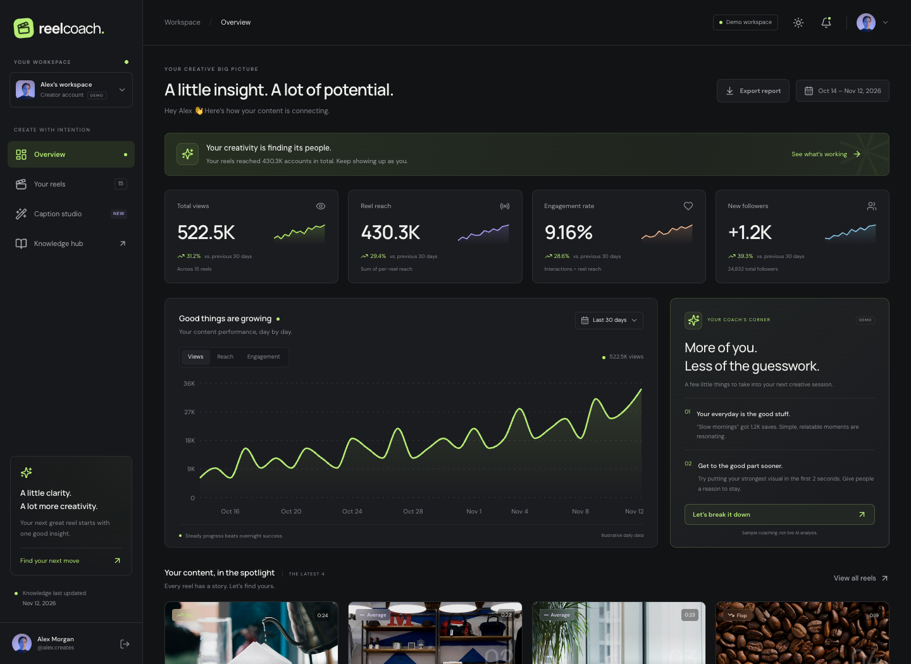

# ReelCoach ✳

**Your next reel, better.** A creator-friendly Instagram strategy workspace built with React, Vite, and TypeScript. Charcoal-and-lime styling, editorial typography, responsive layouts, and persistent light/dark themes.

[Live demo](https://reelcoach.vercel.app) · [Public GitHub repository](https://github.com/Kavya-634/reelcoach)



> Frontend demo only. All creator identities, metrics, and coaching are fictional. There is no Instagram OAuth, real Instagram data, AI API, server-side processing, or analytics tracker.

## Quick start

Requires Node.js **22.12+ in the 22.x release line** and npm. The project pins Node 22 for reproducible Vercel builds.

```sh
git clone https://github.com/Kavya-634/reelcoach.git
cd reelcoach
npm ci
npm run dev
```

Vite prints the local address. No environment variables or API keys are required.

```sh
npm run build          # TypeScript check + production bundle
npm run preview        # Serve the production bundle locally
npm test               # 24 deterministic unit tests
npm run test:watch     # Interactive unit tests
npm run format:check   # Check source formatting
```

## Explore the demo

- **Landing (`/`)** — Introduces ReelCoach. “Try Demo Mode” loads Alex’s sample workspace. “Continue with Instagram” opens an honest explanation that sign-in is not connected; it never collects credentials.
- **Dashboard (`/dashboard`)** — Fictional creator profile, 24,832 followers, four summary metrics, 30 daily data points, metric switching, 7/14/30-day chart ranges, CSV report download, coaching cards, reel spotlights, and a searchable/filterable/sortable paginated metrics table.
- **Reel library (`/reels`)** — All 15 sample reels. Views, reach, likes, comments, shares, saves, average watch time, and creator-relative Hit/Average/Flop badges. Search by title/topic; sort any metric; filter performance.
- **Analysis (`/reels/:id`)** — Metrics, Hook, Script, Voice, Visuals, Pacing, CTA, and Fixes. Copy coaching starters, check off editing experiments, and carry a reel’s topic into Caption Studio. Covers are stock photos, not playable sample reels.
- **Caption Studio (`/studio`)** — Local image/video selection, drag-and-drop, previews, draft-link validation, topic context, three tones, three deterministic caption options, keywords, and up to five hashtags. Copy each output. “Try with sample content” works without selecting a file.
- **Knowledge (`/knowledge`)** — Search/filter creative prompts and platform notes. Visible “Knowledge last updated” date, official-source labels and quotations, original publication dates, source-check dates, and reference links.

Navigation includes a mobile drawer, accessible icon labels, a skip link, keyboard focus indicators, a focus-trapped Instagram explanation dialog, reduced-motion support, and helpful unknown-route states. Wide metric tables scroll inside their own containers rather than widening the phone viewport.

## Mock data and measurement

[src/data/mock.ts](src/data/mock.ts) is the single fixture source. The fixed demo window is **October 14–November 12, 2026**. Daily chart views and reach reconcile with the displayed 30-day totals.

Performance uses the median **views across all 15 reels**, currently **28,700**:

- **Hit:** views ≥ 1.5 × median.
- **Average:** views ≥ 0.75 × median and < 1.5 × median.
- **Flop:** views < 0.75 × median.

Search and filtering never change the baseline. These are product-defined thresholds, not Instagram rules.

Engagement = `(likes + comments + shares + saves) / reach × 100`. The dashboard uses the aggregate interaction/reach ratio. “Reel reach” is a **sum of per-reel reach**, not unique monthly account reach; the same account can appear in more than one reel’s audience. Daily engagement values and prior-period comparisons are independent illustrative fixtures. Average watch time divided by duration is **not** a completion rate, retention curve, or viewer drop-off measurement.

## Knowledge files

- [src/knowledge/trends.json](src/knowledge/trends.json) — Illustrative creative prompts, not live trend reports.
- [src/knowledge/metaRules.json](src/knowledge/metaRules.json) — Platform/editorial notes and `maxHashtags: 5`.

Every entry has `title`, `description`, `source`, and `lastUpdated`. Knowledge Hub now replaces its hashtag-limit warning with **“Keywords first, hashtags with purpose.”** That note links to Instagram's [Tips for Improving Your Reach](https://creators.instagram.com/blog/tips-for-improving-your-reach/?locale=en_US) (May 31, 2023) and [Breaking Down How Instagram Search Works](https://about.instagram.com/blog/announcements/break-down-how-instagram-search-works) (August 25, 2021), both read directly on November 12, 2026. Its official-source quotation, original publication dates, and source-check date are visible in the UI.

The official guidance recommends relevant keywords **and hashtags** for Search. It does not establish that hashtags are dead or that keywords universally outrank hashtags or guarantee Reels reach. Putting natural keywords first in the caption-writing workflow is ReelCoach's practical advice, distinguished from Meta's statements. Other cards remain illustrative/editorial, not verified current trends.

Caption Studio's five-suggestion cap is unchanged. Because JSON does not support comments, the internal `_comment` still reminds maintainers to verify the limit against Meta's official announcement before production; it is no longer a Knowledge Hub card or warning banner.

Update both file-level and per-entry dates when editing. The UI uses those dates, not the browser’s current date. No API automatically refreshes knowledge.

## Privacy and demo boundaries

- Files remain in browser memory using object URLs. They are not uploaded or inspected. Removing a file/unmounting the page releases its preview URL.
- Supported files: JPG, PNG, WebP, MP4, MOV, WebM, up to 100 MB. Media codec playback depends on browser support.
- Draft URLs are validated as HTTP(S) but never fetched, opened, or used to retrieve content.
- Caption output depends on the entered **topic and tone**, not the file’s pixels/audio or link contents. It is local template generation, not AI inference.
- The only persisted preference is `reelcoach-theme` in localStorage. Caption drafts, files, and checklist state do not persist across page reloads.
- Sample images and variable fonts are self-hosted. Reference links leave the app only when clicked.
- Browser clipboard access needs a secure context; if denied, select the visible output text and copy manually.
- This project is independent and not affiliated with Instagram or Meta.

## Deploy to Vercel

The app is deployed at **[reelcoach.vercel.app](https://reelcoach.vercel.app)**. Its public GitHub repository is connected to the Vercel project, so pushes to `main` trigger production builds. To deploy a fork, import your repository in Vercel:

- **Framework:** Vite
- **Root directory:** repository root (`.`)
- **Install command:** `npm ci`
- **Build command:** `npm run build`
- **Output directory:** `dist`
- **Node version:** 22.x
- **Environment variables:** none

[vercel.json](vercel.json) includes SPA rewrites for direct route loads and basic security headers. Static image/font assets remain accessible. Connecting the GitHub repository enables production deployments from `main` and preview deployments for pull requests.

CLI alternative:

```sh
npx vercel login
npx vercel --prod
```

## Browser tests

The Playwright suite runs the same 12 scenarios on desktop and mobile (24 checks): demo entry, Instagram explanation, theme persistence, charts/export/pagination, reel filtering/sorting, all analysis sections, caption generation, draft URL validation, local file previews, source-linked knowledge, unknown routes, and viewport containment.

```sh
npx playwright install chromium
npm run test:e2e
```

To use an installed Chrome instead:

```sh
CHROME_PATH="/path/to/chrome" npm run test:e2e
```

The test server uses port 4198 with `--strictPort` so it cannot accidentally test another project. Set `PLAYWRIGHT_BASE_URL` to test a deployed instance.

Verified: **24 unit tests**, **24 desktop/mobile browser checks**, successful production build, and zero reported npm audit vulnerabilities at the time of delivery.

An optional [GitHub Actions template](docs/ci-template.yml) is included. It is **not active**: the available GitHub OAuth credential lacks the `workflow` scope. Copy it to `.github/workflows/ci.yml` with workflow-write permissions to enable hosted CI. This does not affect Vercel's Git-connected deployments.

## Source map

```text
src/
  App.tsx                  Routes, theme persistence, lazy loading
  main.tsx                 React entry point
  styles.css               Theme tokens, responsive page/component styling
  components/              Navigation shell, modal, badges, copy controls
  pages/                   Landing, Dashboard, Reels, ReelAnalysis, CaptionStudio, Knowledge
  data/mock.ts             Fictional creator and all sample analytics
  lib/analytics.ts         Median, performance classification, engagement calculations
  lib/captions.ts          Deterministic caption templates and draft URL validation
  knowledge/               Date-stamped creative prompts and platform notes
public/images/             Self-hosted stock cover/avatar imagery
e2e/                       Desktop and mobile browser tests
```

## Assets and attribution

Cover and avatar images are downloaded from Unsplash and used only as fictional illustrative content. Their image identifiers are retained in the filenames; the original image endpoints use `https://images.unsplash.com/<photo-id>`. See [Unsplash’s license](https://unsplash.com/license). Real people in the photos are not claimed to be ReelCoach users or the fictional creator.

DM Sans and Manrope are bundled through Fontsource under their respective SIL Open Font Licenses. Lucide icons are distributed under the ISC license.

## Before adding real integrations

Replace fixtures behind a typed data interface; add server-side OAuth/token handling, explicit permissions and consent, validated media ingestion, real analytics, production-safe AI calls, rate limiting, secret management, verified policy sources, and retention/deletion controls. Never put Instagram tokens or AI secrets in `VITE_*` variables: those are shipped to the browser.
